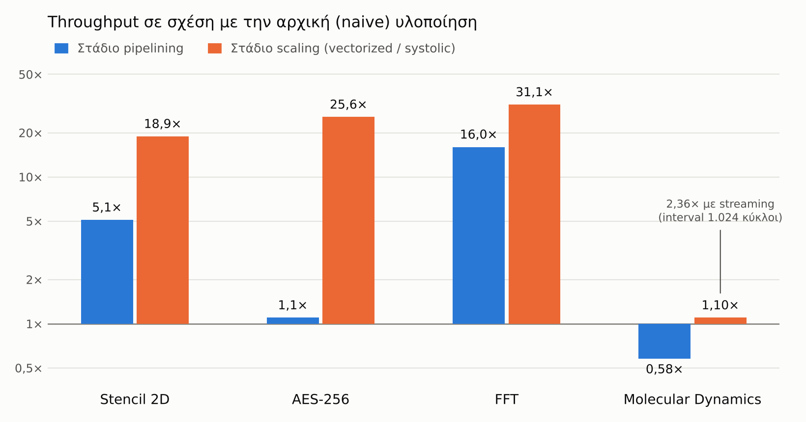
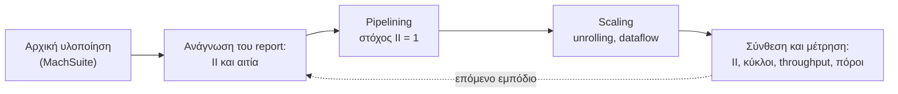

[English](README.md) | **Ελληνικά**

# Μετασχηματισμοί κώδικα για High-Level Synthesis σε FPGA

Τέσσερα υπολογιστικά kernels της σουίτας MachSuite, από τον αρχικό τους κώδικα C σε βελτιστοποιημένους επιταχυντές FPGA, με το AMD Vitis HLS 2024.2. Κάθε βήμα εφαρμόζει συγκεκριμένο μετασχηματισμό από τη μεθοδολογία των de Fine Licht et al. [1], και κάθε βήμα μετριέται: initiation interval, κύκλοι, throughput και κόστος σε hardware.

Το αποθετήριο περιέχει τον κώδικα της διπλωματικής μου εργασίας στο Τμήμα Ηλεκτρολόγων Μηχανικών και Τεχνολογίας Υπολογιστών του Πανεπιστημίου Πατρών (2026). Το πλήρες κείμενο της εργασίας υπάρχει σε PDF στο [τελευταίο release](../../releases/latest).

<picture>
  <source media="(prefers-color-scheme: dark)" srcset="docs/figures/speedup_el_dark.png">
  
</picture>

## Βασικά ευρήματα

- **Η μεθοδολογία δουλεύει, με τη σειρά που ορίζει.** Σε τρία από τα τέσσερα kernels, πρώτα pipelining και μετά scaling έδωσε σταθερή βελτίωση: **18,9×** (stencil), **25,6×** (AES-256) και **31,1×** (FFT) σε throughput έναντι της αρχικής υλοποίησης.
- **Το report της σύνθεσης δείχνει το επόμενο βήμα.** Κάθε βρόχος που δεν πετυχαίνει τον στόχο για το initiation interval αναφέρεται μαζί με την αιτία: είτε εξάρτηση στη μνήμη είτε περιορισμός πόρων (συνήθως τα δύο ports μιας BRAM). Αυτή η αιτία καθόρισε τον επόμενο μετασχηματισμό σε κάθε kernel.
- **Το μεγαλύτερο κέρδος ήρθε σχεδόν δωρεάν.** Στο FFT, η αναδιατύπωση των δεικτών και η δήλωση μιας ψευδούς εξάρτησης έδωσαν **16×** με πρακτικά το ίδιο hardware.
- **Το II = 1 δεν είναι αυτοσκοπός.** Στο molecular dynamics το pipelining έκανε το kernel *πιο αργό* (0,58×), γιατί το εργαλείο είχε ήδη ξετυλίξει μόνο του τον εσωτερικό βρόχο στην αρχική υλοποίηση. Το scaling το επανέφερε, και η σχεδίαση κερδίζει κυρίως όταν τα προβλήματα έρχονται το ένα μετά το άλλο.

## Τα kernels

Τα τέσσερα kernels διαλέχτηκαν ώστε το καθένα να περιορίζεται από κάτι διαφορετικό, και άρα να χρειάζεται διαφορετικό κομμάτι της μεθοδολογίας.

| Kernel | Πρόβλημα | Εμπόδιο της αρχικής υλοποίησης | Μετασχηματισμοί |
|---|---|---|---|
| **Stencil 2D** | Πλέγμα 128×64, φίλτρο 3×3, `int32_t` | 9 αναγνώσεις ανά έξοδο σε BRAM με 2 ports → II = 5 | Delay buffers (line buffers), loop flattening, horizontal unrolling (W = 4), cyclic partitioning |
| **AES-256** | Ένα block 128 bit σε ECB, `uint8_t` | Εξάρτηση από round σε round → II = 16, και πολλαπλά αντίγραφα της λογικής του S-box | Inlining, S-box σε LUTRAM, unrolling στα bytes, complete partitioning του S-box |
| **FFT** | 1.024 σημεία, radix-2, `double` | Ψευδής εξάρτηση στον πίνακα που γράφεται επί τόπου → II = 16 | Loop coalescing (affine δείκτες), memory access extraction, `DEPENDENCE false`, χωριστός buffer ανά stage |
| **Molecular Dynamics** | 256 άτομα × 16 γείτονες, Lennard-Jones, `double` | Τυχαία πρόσβαση μέσω neighbor list, 17 αναγνώσεις σε 2 ports → II = 9 | Tiled accumulation, loop flattening, 4 processing elements σε `DATAFLOW` με αντίγραφα των θέσεων |

Κάθε kernel έχει την ίδια top function και το ίδιο interface και στα τρία στάδια (`stencil`, `aes256_encrypt_ecb`, `fft`, `md_kernel`). Έτσι τα στάδια αντικαθιστούν άμεσα το ένα το άλλο, και τα testbenches τους διαφέρουν μόνο στο header που κάνουν include.

## Η μεθοδολογία

Οι 15 μετασχηματισμοί του [1] χωρίζονται σε τρεις ομάδες: όσοι κάνουν δυνατό το pipelining (στόχος II = 1), όσοι κάνουν scaling σε ένα κύκλωμα που ήδη τρέχει με II = 1, και όσοι οργανώνουν την πρόσβαση στη μνήμη ώστε να λειτουργούν οι δύο πρώτες. Εδώ εφαρμόστηκαν οι 13. Ο pipelined loop switching δεν βρήκε κατάλληλη δομή βρόχων σε αυτά τα kernels, και το type demotion αφέθηκε σκόπιμα εκτός, γιατί η αλλαγή ακρίβειας θα έκανε τα στάδια μη συγκρίσιμα με τη MachSuite.

Σε κάθε kernel ακολουθήθηκε ο ίδιος κύκλος:



## Αποτελέσματα

Όλα τα νούμερα είναι εκτιμήσεις της C synthesis για Virtex UltraScale+, με στόχο clock 10 ns, εκτός από τα δύο vectorized στάδια του AES, που έχουν στόχο 7 ns. Όλες οι συνθέσεις έγιναν για το `xcvu35p-fsvh2104-2L-e`. Οι κύκλοι και το II προκύπτουν από το schedule, είναι ακριβή και δεν εξαρτώνται από το chip. Οι πόροι και η περίοδος είναι εκτιμήσεις πριν από τη λογική σύνθεση.

Το throughput είναι το έργο W μίας εκτέλεσης διά τον χρόνο της, δηλαδή τους κύκλους C επί την εκτιμώμενη περίοδο t:

```
T = W / (C × t)
```

Το W είναι 132.804 πράξεις για το stencil (7.812 εσωτερικά σημεία × 17), 128 bit για το AES, 51.200 πράξεις κινητής υποδιαστολής για το FFT (5.120 πεταλούδες × 10) και 86.016 για το molecular dynamics (4.096 ζεύγη × 21). Όλες οι συγκρίσεις αφορούν μία εκτέλεση του kernel, όπως την ορίζει η MachSuite.

| Kernel | Στάδιο | II | Κύκλοι | Περίοδος (ns) | Throughput | vs αρχική | LUT | FF | DSP | BRAM |
|---|---|---:|---:|---:|---:|---:|---:|---:|---:|---:|
| Stencil | αρχική | 5 | 39.068 | 7,128 | 0,48 GOp/s | 1× | 948 | 572 | 6 | 0 |
| | pipelined † | 1 | 8.209 | 6,611 | 2,45 GOp/s | 5,1× | 1.238 | 912 | 27 | 0 |
| | vectorized (W = 4) † | 1 | 2.067 | 7,136 | 9,0 GOp/s | 18,9× | 4.111 | 2.034 | 108 | 0 |
| AES-256 | αρχική | 16 | 459 | 7,291 | 38,2 Mbit/s | 1× | 538.847 | 72.496 | 0 | 0 |
| | pipelined | 12 | 434 | 7,137 | 41,3 Mbit/s | 1,1× | 176.234 | 22.141 | 0 | 0 |
| | vectorized, S-box σε LUTRAM | 12 | 227 | 2,228 | 253,1 Mbit/s | 6,6× | 4.004 | 4.779 | 0 | 0 |
| | vectorized, S-box σε registers | 1 | 33 | 3,964 | 978,5 Mbit/s | 25,6× | 79.632 | 2.482 | 0 | 0 |
| FFT | αρχική † | 16 | 163.881 | 7,088 | 44,1 MFLOPS | 1× | 2.347 | 2.914 | 38 | 0 |
| | pipelined | 2 | 10.255 | 7,088 | 704,4 MFLOPS | 16,0× | 3.394 | 3.868 | 25 | 0 |
| | systolic | 1 | 5.262 | 7,088 | 1.372,8 MFLOPS | 31,1× | 12.376 | 16.807 | 50 | 144 |
| MD | αρχική | 9 | 2.419 | 7,088 | 5,02 GFLOPS | 1× | 20.870 | 35.562 | 208 | 0 |
| | pipelined | 1 | 4.167 | 7,088 | 2,91 GFLOPS | 0,58× | 16.775 | 14.725 | 151 | 0 |
| | systolic (P = 4) † | 1 | 2.198 | 7,088 | 5,52 GFLOPS | 1,10× | 95.152 | 92.070 | 712 | 76 |

Η systolic σχεδίαση του molecular dynamics έχει interval 1.024 κύκλων στην top function, οπότε νέο πρόβλημα μπορεί να ξεκινήσει πριν τελειώσει το προηγούμενο. Με συνεχή ροή προβλημάτων το throughput φτάνει τα 11,85 GFLOPS (2,36× έναντι της αρχικής).

Η εκτίμηση των 538.847 LUT στο αρχικό AES είναι υπερβολική: το εργαλείο αναπαράγει πολλές φορές τη λογική του key expansion και του S-box. Σημασία έχει η τάξη μεγέθους και η μεταβολή ανάμεσα στα στάδια, όχι η απόλυτη τιμή.

## Δομή του αποθετηρίου

Τα τέσσερα kernels είναι αριθμημένα με τη σειρά που εμφανίζονται στη διπλωματική. Κάθε φάκελος kernel έχει έναν υποφάκελο ανά στάδιο, και κάθε υποφάκελος περιέχει τον κώδικα του kernel, το header του και ένα testbench.

```
.
├── 1_Stencil_2D_9_Point/
│   ├── Stencil_Naive/                    stencil.c/.h, stencil_tb.c
│   ├── Stencil_Pipelined/                stencil_pipelined.c/.h, stencil_pipelined_tb.c
│   └── Stencil_Vectorized/               stencil_vectorized.c/.h, stencil_vectorized_tb.c
├── 2_Advanced_Encryption_Standard/
│   ├── AES_Naive/                        aes.c/.h, aes_tb.c
│   ├── AES_Pipelined/                    aes_pipelined.c/.h, aes_pipelined_tb.c
│   └── AES_Vectorized/                   aes_vectorized.c/.h, aes_vectorized_tb.c
├── 3_Fast_Fourier_Transform_Strided/
│   ├── FFT_MachSuite_Original/           ο αρχικός κώδικας της MachSuite (βλ. παρακάτω)
│   ├── FFT_Naive/                        fft_strided.c/.h, fft_strided_tb.c
│   ├── FFT_Pipelined/                    προηγούμενη απόπειρα (βλ. παρακάτω)
│   ├── FFT_Pipelined_V2/                 fft_pipelined_v2.c/.h, fft_pipelined_v2_tb.c
│   └── FFT_Systolic/                     fft_strided_systolic.c/.h, fft_strided_systolic_tb.c
├── 4_N-Body_Molecular_Dynamics/
│   ├── MD_Naive/                         md.c/.h, md_kernel_tb.c
│   ├── MD_Pipelined/                     προηγούμενη παραλλαγή (βλ. παρακάτω)
│   ├── MD_Pipelined_V2/                  md_pipelined.c/.h, md_pipelined_tb.c
│   └── MD_Systolic/                      md_systolic.c/.h, md_systolic_tb.c
├── Exploration_not_used_in_thesis/
│   ├── Matrix_Multiplication_Reference/
│   ├── Nbody_Reference/
│   └── Stencil_Reference/
└── docs/figures/                         τα γραφήματα αυτού του README
```

### Ποιοι φάκελοι έδωσαν τα αποτελέσματα

| Kernel | Αρχική | Στάδιο pipelining | Στάδιο scaling |
|---|---|---|---|
| Stencil 2D | `Stencil_Naive` | `Stencil_Pipelined` | `Stencil_Vectorized` |
| AES-256 | `AES_Naive` | `AES_Pipelined` | `AES_Vectorized` (δύο παραλλαγές, βλ. σημειώσεις) |
| FFT | `FFT_Naive` | `FFT_Pipelined_V2` | `FFT_Systolic` |
| Molecular Dynamics | `MD_Naive` | `MD_Pipelined_V2` | `MD_Systolic` |

### Ενδιάμεσες εκδόσεις και διερεύνηση

Οι υπόλοιποι φάκελοι κρατήθηκαν ως καταγραφή της πορείας της δουλειάς. Κανένας δεν εμφανίζεται στα αποτελέσματα.

| Φάκελος | Τι περιέχει |
|---|---|
| `FFT_MachSuite_Original` | Το αυτούσιο kernel `fft/strided` της MachSuite, για αναφορά, με testbench στη θέση του test harness της MachSuite. Συντίθεται, αλλά το report δεν δίνει αριθμό κύκλων: ο εξωτερικός βρόχος υποδιπλασιάζει το `span` μέχρι να μηδενιστεί και ο εσωτερικός αλλάζει τον ίδιο του τον μετρητή (`odd \|= span`). Έτσι το Vitis HLS δεν μπορεί να υπολογίσει τα trip counts και δίνει το latency ως άγνωστο (`?`). Γι' αυτό το `FFT_Naive` ξαναγράφει τις κεφαλίδες των δύο βρόχων με απλούς μετρητές. Ο υπολογισμός μένει ίδιος και η έξοδος ταυτίζεται.  |
| `FFT_Pipelined` | Πρώτη απόπειρα pipelining. Κρατά τον βρόχο πάνω στο `odd` με `if ((odd & span) == 0) continue`, οπότε οι μισές επαναλήψεις δεν κάνουν τίποτα, και προσθέτει cyclic partitioning με factor 2. Το αντικατέστησε το `FFT_Pipelined_V2`. |
| `MD_Pipelined` | Παραλλαγή με loop flattening: η αρχικοποίηση, ο εσωτερικός βρόχος και η σύμπτυξη των μερικών αθροισμάτων σε έναν pipelined βρόχο, με συνθήκες στο `j` και `TILE_SIZE 8`. Στο στάδιο pipelining το αντικατέστησε το `MD_Pipelined_V2` (χωριστοί βρόχοι, `TILE_SIZE 4`), όμως η δομή του βρόχου του ζει μέσα στα processing elements του `MD_Systolic`. |
| `Exploration_not_used_in_thesis/Matrix_Multiplication_Reference` | Πολλαπλασιασμός πινάκων 64×64 σε `double`, σε τρία στάδια (reference, pipelined, vectorized), με testbenches. Ένα πρώτο πέρασμα από τη μεθοδολογία πριν από τη MachSuite. |
| `Exploration_not_used_in_thesis/Nbody_Reference` | Βαρυτική προσομοίωση N σωμάτων (160 σώματα, 4 χρονικά βήματα, `float`) σε απλή C, με testbench που ελέγχει μόνο του το αποτέλεσμα. Στη διπλωματική χρησιμοποιήθηκε τελικά το molecular dynamics της MachSuite. |
| `Exploration_not_used_in_thesis/Stencil_Reference` | Jacobi stencil 5 σημείων σε πλέγμα 12×12 `float`, δύο εκδόσεις σε απλή C. Πρώτη επαφή με stencils, πριν από το `stencil2d` της MachSuite. |

## Εκτέλεση

Απαιτείται το AMD Vitis 2024.2 (Vitis HLS). Τα αρχεία ρυθμίσεων του Vitis δεν περιλαμβάνονται στο αποθετήριο, γιατί οι συνθέσεις έγιναν από ξεχωριστό workspace. Για να ξαναγίνει η σύνθεση ενός σταδίου, φτιάξτε ένα `hls_config.cfg` μέσα στον φάκελό του. Για το αρχικό stencil:

```ini
part=xcvu35p-fsvh2104-2L-e

[hls]
flow_target=vivado
package.output.format=ip_catalog

syn.top=stencil
syn.file=stencil.c
syn.file=stencil.h
tb.file=stencil_tb.c
csim.code_analyzer=1
```

Στα υπόλοιπα στάδια αλλάζουν τα ονόματα των αρχείων και η top function (`aes256_encrypt_ecb`, `fft`, `md_kernel`). Χωρίς γραμμή `clock` ο στόχος είναι 10 ns. Τα δύο vectorized στάδια του AES προσθέτουν `clock=7ns`.

Στη συνέχεια, από τον ίδιο φάκελο:

**C simulation** (έλεγχος ορθότητας με το testbench):

```bash
vitis-run --mode hls --csim --config hls_config.cfg --work_dir build
```

**C synthesis** (παράγει RTL και τα reports με II, κύκλους και πόρους):

```bash
v++ -c --mode hls --config hls_config.cfg --work_dir build
```

Το report της σύνθεσης γράφεται στο `build/hls/syn/report/`. Τα ίδια αρχεία ανοίγουν και ως HLS component στο Vitis IDE.

### Έλεγχος ορθότητας

Τα testbenches παράγουν μόνα τους την είσοδο, οπότε δεν χρειάζονται αρχεία δεδομένων.

- **Stencil:** τυχαίο πλέγμα και φίλτρο με σταθερό seed. Κάθε έξοδος συγκρίνεται με μια υλοποίηση αναφοράς σε software, και το testbench επιστρέφει PASS ή FAIL.
- **AES-256:** κρυπτογραφεί το test vector του FIPS-197 (κλειδί `00 01 … 1f`) και τυπώνει το κρυπτοκείμενο δίπλα στο αναμενόμενο, `8e a2 b7 ca 51 67 45 bf ea fc 49 90 4b 49 60 89`.
- **FFT:** μετασχηματίζει μια γραμμική είσοδο (ramp) και τυπώνει και τις 1.024 εξόδους.
- **Molecular Dynamics:** τυχαίες θέσεις ατόμων με σταθερό seed, neighbor list που χτίζεται στο testbench, και εκτύπωση των δυνάμεων των πρώτων ατόμων.

Στο FFT και στο molecular dynamics, ένα βελτιστοποιημένο στάδιο ελέγχεται συγκρίνοντας την έξοδό του με αυτή της αρχικής υλοποίησης.

## Σημειώσεις και περιορισμοί

- **Δύο παραλλαγές του AES σε ένα αρχείο.** Οι παραλλαγές «S-box σε LUTRAM» και «S-box σε registers» διαφέρουν κατά μία γραμμή στο `aes_vectorized.c`: το `#pragma HLS ARRAY_PARTITION variable=sbox complete`, μέσα στο πλαίσιο `ON OR OFF`. Με τη γραμμή ενεργή παίρνετε την παραλλαγή με registers, σε σχόλιο την παραλλαγή με LUTRAM.
- **Τα stages του systolic FFT εκτελούνται διαδοχικά.** Το `INLINE` στη `fft_stage` κάνει το εργαλείο να ενώσει τις δέκα κλήσεις σε μία διεργασία μέσα στο `DATAFLOW` (warning `HLS 214-273` στο log). Γι' αυτό το interval ισούται με το latency (5.263 κύκλοι). Το κέρδος έναντι του pipelined έρχεται από τον χωριστό buffer ανά stage, που επιτρέπει II = 1, και όχι από ταυτόχρονη εκτέλεση.
- **Μέγεθος tile στο MD.** Το στάδιο pipelining (`MD_Pipelined_V2`) χρησιμοποιεί `TILE_SIZE 4`. Τα processing elements του systolic σταδίου βασίζονται στον flattened βρόχο της προηγούμενης παραλλαγής `MD_Pipelined` και κρατούν το `TILE_SIZE 8` της (στο `md_systolic.h`).
- **Αρχική υλοποίηση του FFT.** Το `FFT_Naive` διαφέρει από τον αρχικό κώδικα της MachSuite (`FFT_MachSuite_Original`) μόνο στις κεφαλίδες των βρόχων. Και οι δύο βρόχοι χρησιμοποιούν απλούς μετρητές (γραμμικό μετρητή για τα stages αντί για υποδιπλασιασμό του `span`, και `continue` αντί για `odd |= span`), ώστε το εργαλείο να υπολογίζει τα trip counts. Ο υπολογισμός και η έξοδος μένουν ίδια.
- **Εκτιμήσεις, όχι μετρήσεις.** Δεν έχει γίνει RTL co-simulation ούτε place and route. Οι κύκλοι είναι αξιόπιστοι· οι πόροι και η συχνότητα θέλουν επιβεβαίωση σε πλήρη υλοποίηση.

## Μελλοντικές επεκτάσεις

- **Επικάλυψη των stages του FFT.** Αν κάθε stage μείνει ξεχωριστή διεργασία dataflow (με template ή `FUNCTION_INSTANTIATE` αντί για `INLINE`), με ping-pong buffers ανάμεσα, διαδοχικοί μετασχηματισμοί θα επικαλύπτονται. Το interval θα έπεφτε περίπου στη διάρκεια ενός stage (~525 κύκλοι) αντί για δέκα.
- **Unrolling πάνω στο tiled accumulation του MD**, ώστε να κρατηθεί η παραλληλία της αρχικής υλοποίησης χωρίς την εξάρτησή της.
- **Type demotion** (`float` ή fixed point) στο FFT και στο MD, με μέτρηση του αριθμητικού σφάλματος.
- **RTL co-simulation και place and route** για όλες τις υλοποιήσεις.

## Αναφορές

1. J. de Fine Licht, M. Besta, S. Meierhans, T. Hoefler, «Transformations of High-Level Synthesis Codes for High-Performance Computing», *IEEE Transactions on Parallel and Distributed Systems*, vol. 32, no. 5, pp. 1014–1029, 2021.
2. B. Reagen, R. Adolf, Y. S. Shao, G.-Y. Wei, D. Brooks, «MachSuite: Benchmarks for Accelerator Design and Customized Architectures», *IEEE International Symposium on Workload Characterization (IISWC)*, 2014.
3. AMD, *Vitis High-Level Synthesis User Guide* (UG1399), έκδοση 2024.2.

## Συγγραφέας

**Ευθύμιος Πανίδης**, Εργαστήριο VLSI, Τμήμα Ηλεκτρολόγων Μηχανικών και Τεχνολογίας Υπολογιστών, Πανεπιστήμιο Πατρών.
Επιβλέπων: Αναπλ. Καθ. Γεώργιος Θεοδωρίδης.

Οι αρχικές υλοποιήσεις προέρχονται από τη MachSuite [2] και διέπονται από την άδειά της.

```bibtex
@mastersthesis{panidis2026hls,
  author = {Πανίδης, Ευθύμιος},
  title  = {Μελέτη αλγοριθμικών μετασχηματισμών για την υλοποίηση εφαρμογών με χρήση HLS σε τεχνολογία FPGA},
  school = {Πανεπιστήμιο Πατρών, Τμήμα Ηλεκτρολόγων Μηχανικών και Τεχνολογίας Υπολογιστών},
  year   = {2026},
  type   = {Διπλωματική εργασία}
}
```
