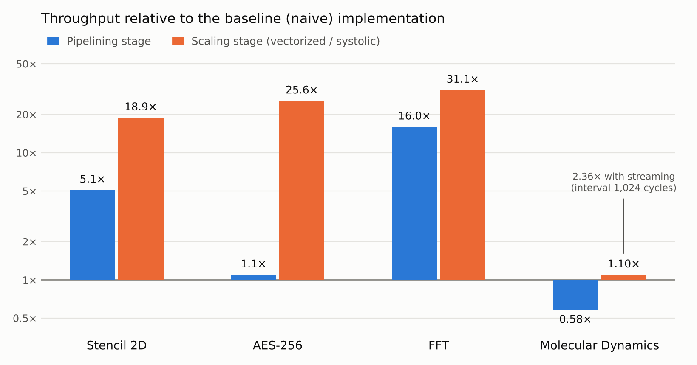
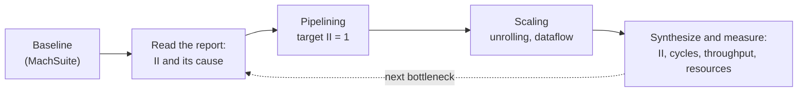

**English** | [Ελληνικά](README.el.md)

# Code Transformations for High-Level Synthesis on FPGA

Four compute kernels from the MachSuite benchmark suite, taken from their baseline C code to optimized FPGA accelerators with AMD Vitis HLS 2024.2. Each step applies a specific transformation from the methodology of de Fine Licht et al. [1], and each step is measured: initiation interval, cycles, throughput and hardware cost.

This repository contains the source code of my diploma thesis at the Department of Electrical and Computer Engineering, University of Patras (2026). The full report, in Greek, is attached to the [latest release](../../releases/latest).

<picture>
  <source media="(prefers-color-scheme: dark)" srcset="docs/figures/speedup_en_dark.png">
  
</picture>

## Key findings

- **The methodology works, in the order it prescribes.** In three of the four kernels, pipelining first and scaling second gave a steady improvement: **18.9×** (stencil), **25.6×** (AES-256) and **31.1×** (FFT) in throughput over the baseline.
- **The synthesis report points to the next step.** Every missed initiation interval is reported with its cause, either a memory dependency or a resource limit (usually the two ports of a block RAM). That cause decided the next transformation in every kernel.
- **The largest gain came almost for free.** In the FFT, rewriting the index arithmetic and declaring a false dependency gave **16×** with practically the same hardware.
- **II = 1 is not the goal by itself.** In molecular dynamics, pipelining made the kernel *slower* (0.58×), because the tool had already unrolled the inner loop of the baseline on its own. Scaling recovered the loss, and the design pays off mainly when problems are streamed back to back.

## Kernels

The four kernels were chosen so that each one is limited by something different, and therefore exercises a different part of the methodology.

| Kernel | Problem | Bottleneck of the baseline | Transformations applied |
|---|---|---|---|
| **Stencil 2D** | 128×64 grid, 3×3 filter, `int32_t` | 9 reads per output on a 2-port BRAM → II = 5 | Delay buffers (line buffers), loop flattening, horizontal unrolling (W = 4), cyclic partitioning |
| **AES-256** | One 128-bit block, ECB mode, `uint8_t` | Round-to-round memory dependency → II = 16, plus replicated S-box logic | Function inlining, S-box in LUTRAM, byte-level unrolling, complete partitioning of the S-box |
| **FFT** | 1,024 points, radix-2, `double` | False dependency on the in-place array → II = 16 | Loop coalescing (affine indices), memory access extraction, `DEPENDENCE false`, a separate buffer per stage |
| **Molecular Dynamics** | 256 atoms × 16 neighbors, Lennard-Jones, `double` | Random access through the neighbor list, 17 reads on 2 ports → II = 9 | Tiled accumulation, loop flattening, 4 processing elements in `DATAFLOW` with replicated positions |

Every kernel keeps the same top function and interface across its three stages (`stencil`, `aes256_encrypt_ecb`, `fft`, `md_kernel`), so the stages are drop-in replacements for each other and their testbenches differ only in the header they include.

## Methodology

The 15 transformations of [1] fall into three groups: those that enable pipelining (target II = 1), those that scale a design that already runs at II = 1, and those that organize memory access so the first two can work. Thirteen of them were applied here. Pipelined loop switching found no suitable loop structure in these kernels, and type demotion was left out on purpose, because changing precision would make the stages no longer comparable with the MachSuite baseline.

Each kernel went through the same loop:



## Results

All figures are C-synthesis estimates for Virtex UltraScale+ parts with a 10 ns clock target, except the two vectorized AES stages, which target 7 ns. All runs used the `xcvu35p-fsvh2104-2L-e` part. Cycle counts and II come from the schedule, are exact and do not depend on the part. Resources and clock period are estimates made before logic synthesis.

Throughput is the work W of one execution divided by its time, that is the cycle count C times the estimated clock period t:

```
T = W / (C × t)
```

W is 132,804 operations for the stencil (7,812 interior points × 17), 128 bits for AES, 51,200 floating-point operations for the FFT (5,120 butterflies × 10) and 86,016 for molecular dynamics (4,096 pairs × 21). All comparisons use a single execution of the kernel, as MachSuite defines it.

| Kernel | Stage | II | Cycles | Period (ns) | Throughput | vs. baseline | LUT | FF | DSP | BRAM |
|---|---|---:|---:|---:|---:|---:|---:|---:|---:|---:|
| Stencil | baseline | 5 | 39,068 | 7.128 | 0.48 GOp/s | 1× | 948 | 572 | 6 | 0 |
| | pipelined | 1 | 8,209 | 6.611 | 2.45 GOp/s | 5.1× | 1,238 | 912 | 27 | 0 |
| | vectorized (W = 4) | 1 | 2,067 | 7.136 | 9.0 GOp/s | 18.9× | 4,111 | 2,034 | 108 | 0 |
| AES-256 | baseline | 16 | 459 | 7.291 | 38.2 Mbit/s | 1× | 538,847 | 72,496 | 0 | 0 |
| | pipelined | 12 | 434 | 7.137 | 41.3 Mbit/s | 1.1× | 176,234 | 22,141 | 0 | 0 |
| | vectorized, S-box in LUTRAM | 12 | 227 | 2.228 | 253.1 Mbit/s | 6.6× | 4,004 | 4,779 | 0 | 0 |
| | vectorized, S-box in registers | 1 | 33 | 3.964 | 978.5 Mbit/s | 25.6× | 79,632 | 2,482 | 0 | 0 |
| FFT | baseline | 16 | 163,881 | 7.088 | 44.1 MFLOPS | 1× | 2,347 | 2,914 | 38 | 0 |
| | pipelined | 2 | 10,255 | 7.088 | 704.4 MFLOPS | 16.0× | 3,394 | 3,868 | 25 | 0 |
| | systolic | 1 | 5,262 | 7.088 | 1,372.8 MFLOPS | 31.1× | 12,376 | 16,807 | 50 | 144 |
| MD | baseline | 9 | 2,419 | 7.088 | 5.02 GFLOPS | 1× | 20,870 | 35,562 | 208 | 0 |
| | pipelined | 1 | 4,167 | 7.088 | 2.91 GFLOPS | 0.58× | 16,775 | 14,725 | 151 | 0 |
| | systolic (P = 4) | 1 | 2,198 | 7.088 | 5.52 GFLOPS | 1.10× | 95,152 | 92,070 | 712 | 76 |

The systolic molecular dynamics design has a top-level interval of 1,024 cycles, so a new problem can start before the previous one finishes. With a continuous stream of problems its throughput reaches 11.85 GFLOPS (2.36× over the baseline).

The 538,847 LUT estimate of the baseline AES is inflated: the tool replicates the key-expansion and S-box logic many times. What matters is the order of magnitude and the change between stages, not the absolute number.

## Repository structure

The four kernels are numbered in the order they appear in the thesis. Each kernel folder has one subfolder per stage, and every subfolder holds the kernel source, its header and a testbench.

```
.
├── 1_Stencil_2D_9_Point/
│   ├── Stencil_Naive/                    stencil.c/.h, stencil_tb.c
│   ├── Stencil_Pipelined/                stencil_pipelined.c/.h, stencil_pipelined_tb.c
│   └── Stencil_Vectorized/               stencil_vectorized.c/.h, stencil_vectorized_tb.c
├── 2_Advanced_Encryption_Standard/
│   ├── AES_Naive/                        aes.c/.h, aes_tb.c
│   ├── AES_Pipelined/                    aes_pipelined.c/.h, aes_pipelined_tb.c
│   └── AES_Vectorized/                   aes_vectorized.c/.h, aes_vectorized_tb.c
├── 3_Fast_Fourier_Transform_Strided/
│   ├── FFT_MachSuite_Original/           original MachSuite code (see below)
│   ├── FFT_Naive/                        fft_strided.c/.h, fft_strided_tb.c
│   ├── FFT_Pipelined/                    earlier attempt (see below)
│   ├── FFT_Pipelined_V2/                 fft_pipelined_v2.c/.h, fft_pipelined_v2_tb.c
│   └── FFT_Systolic/                     fft_strided_systolic.c/.h, fft_strided_systolic_tb.c
├── 4_N-Body_Molecular_Dynamics/
│   ├── MD_Naive/                         md.c/.h, md_kernel_tb.c
│   ├── MD_Pipelined/                     earlier variant (see below)
│   ├── MD_Pipelined_V2/                  md_pipelined.c/.h, md_pipelined_tb.c
│   └── MD_Systolic/                      md_systolic.c/.h, md_systolic_tb.c
├── Exploration_not_used_in_thesis/
│   ├── Matrix_Multiplication_Reference/
│   ├── Nbody_Reference/
│   └── Stencil_Reference/
└── docs/figures/                         figures of this README
```

### Which folders produced the results

| Kernel | Baseline | Pipelining stage | Scaling stage |
|---|---|---|---|
| Stencil 2D | `Stencil_Naive` | `Stencil_Pipelined` | `Stencil_Vectorized` |
| AES-256 | `AES_Naive` | `AES_Pipelined` | `AES_Vectorized` (two variants, see the notes) |
| FFT | `FFT_Naive` | `FFT_Pipelined_V2` | `FFT_Systolic` |
| Molecular Dynamics | `MD_Naive` | `MD_Pipelined_V2` | `MD_Systolic` |

### Intermediate versions and exploration

The remaining folders are kept as a record of how the work evolved. None of them appears in the results.

| Folder | What it is |
|---|---|
| `FFT_MachSuite_Original` | The unmodified `fft/strided` kernel of MachSuite, kept for reference, with a testbench in place of the MachSuite harness. It synthesizes, but the report gives no cycle count: the outer loop halves `span` until it reaches zero and the inner loop changes its own counter (`odd \|= span`), so Vitis HLS cannot work out the trip counts and reports the latency as unknown (`?`). That is why `FFT_Naive` rewrites the two loop headers with plain counters. The computation is the same and the output identical. |
| `FFT_Pipelined` | First pipelining attempt. It keeps the loop over `odd` with `if ((odd & span) == 0) continue`, so half of the iterations do nothing, and adds cyclic partitioning with factor 2. `FFT_Pipelined_V2` replaced it. |
| `MD_Pipelined` | Flattened variant: initialization, inner loop and collapse of the partial sums merged into one pipelined loop with conditionals on `j`, with `TILE_SIZE 8`. `MD_Pipelined_V2` (separate loops, `TILE_SIZE 4`) replaced it in the pipelining stage, but its loop structure lives on inside the processing elements of `MD_Systolic`. |
| `Exploration_not_used_in_thesis/Matrix_Multiplication_Reference` | 64×64 `double` matrix multiplication in three stages (reference, pipelined, vectorized), with testbenches. A first pass through the methodology before MachSuite. |
| `Exploration_not_used_in_thesis/Nbody_Reference` | Gravitational N-body simulation (160 bodies, 4 time steps, `float`) in plain C, with a self-checking testbench. The thesis used the MachSuite molecular dynamics kernel instead. |
| `Exploration_not_used_in_thesis/Stencil_Reference` | 5-point Jacobi stencil on a 12×12 `float` grid, two plain C versions. First contact with stencils, before the MachSuite `stencil2d`. |

## Building

Requires AMD Vitis 2024.2 (Vitis HLS). The Vitis configuration files are not part of the repository, because the runs were made from a separate Vitis workspace. To rebuild a stage, create an `hls_config.cfg` inside its folder. For the baseline stencil:

```ini
part=xcvu35p-fsvh2104-2L-e

[hls]
flow_target=vivado
package.output.format=ip_catalog

syn.top=stencil
syn.file=stencil.c
syn.file=stencil.h
tb.file=stencil_tb.c
csim.code_analyzer=1
```

For the other stages, change the file names and the top function (`aes256_encrypt_ecb`, `fft`, `md_kernel`). Without a `clock` line the target is 10 ns. The two vectorized AES stages add `clock=7ns`.

Then, from the same folder:

**C simulation** (functional check with the testbench):

```bash
vitis-run --mode hls --csim --config hls_config.cfg --work_dir build
```

**C synthesis** (generates RTL and the reports with II, cycles and resources):

```bash
v++ -c --mode hls --config hls_config.cfg --work_dir build
```

The synthesis report is written to `build/hls/syn/report/`. The same files can also be opened as an HLS component in the Vitis IDE.

### Verification

The testbenches generate their own input, so no data files are needed.

- **Stencil:** random grid and filter with a fixed seed. Every output is compared with a software reference of the filter, and the testbench returns PASS or FAIL.
- **AES-256:** encrypts the FIPS-197 test vector (key `00 01 … 1f`) and prints the ciphertext next to the expected one, `8e a2 b7 ca 51 67 45 bf ea fc 49 90 4b 49 60 89`.
- **FFT:** transforms a ramp input and prints all 1,024 outputs.
- **Molecular Dynamics:** random atom positions with a fixed seed, a neighbor list built in the testbench, and the forces of the first atoms printed.

For the FFT and molecular dynamics, an optimized stage is checked by comparing its printed output with that of the baseline.

## Notes and limitations

- **Two AES variants in one file.** The "S-box in LUTRAM" and "S-box in registers" variants differ by one line in `aes_vectorized.c`: `#pragma HLS ARRAY_PARTITION variable=sbox complete`, inside the `ON OR OFF` block. Keep it for the register variant, comment it out for the LUTRAM variant.
- **FFT systolic stages run one after another.** The `INLINE` on `fft_stage` makes the tool merge the ten calls into a single process inside the `DATAFLOW` region (warning `HLS 214-273` in the log), so the interval equals the latency (5,263 cycles). The gain over the pipelined stage comes from the separate buffer per stage, which allows II = 1, not from concurrent execution.
- **MD tile size.** The pipelining stage (`MD_Pipelined_V2`) uses `TILE_SIZE 4`. The processing elements of the systolic stage are built on the flattened loop of the earlier `MD_Pipelined` variant and keep its `TILE_SIZE 8` (in `md_systolic.h`).
- **FFT baseline.** `FFT_Naive` differs from the original MachSuite code (`FFT_MachSuite_Original`) only in its loop headers. Both loops use plain counters (a linear stage counter instead of halving `span`, and a `continue` instead of `odd |= span`), so the tool can compute the trip counts. The computation and the output are the same.
- **Estimates, not measurements.** No RTL co-simulation or place-and-route has been run. Cycle counts are reliable; resources and clock frequency need confirmation in a full implementation.

## Future work

- **Overlapping FFT stages.** Keeping each stage as a separate dataflow process (a template or `FUNCTION_INSTANTIATE` instead of `INLINE`) with ping-pong buffers would let consecutive transforms overlap, with an estimated interval of about one stage (~525 cycles) instead of ten.
- **Unrolling on top of tiled accumulation in MD**, to keep the parallelism of the baseline without its dependency.
- **Type demotion** (`float` or fixed point) in the FFT and MD, measured against numerical error.
- **RTL co-simulation and place-and-route** for all implementations.

## References

1. J. de Fine Licht, M. Besta, S. Meierhans, T. Hoefler, "Transformations of High-Level Synthesis Codes for High-Performance Computing," *IEEE Transactions on Parallel and Distributed Systems*, vol. 32, no. 5, pp. 1014–1029, 2021.
2. B. Reagen, R. Adolf, Y. S. Shao, G.-Y. Wei, D. Brooks, "MachSuite: Benchmarks for Accelerator Design and Customized Architectures," *IEEE International Symposium on Workload Characterization (IISWC)*, 2014.
3. AMD, *Vitis High-Level Synthesis User Guide* (UG1399), version 2024.2.

## Author

**Efthymios Panidis**, VLSI Laboratory, Department of Electrical and Computer Engineering, University of Patras.
Supervisor: Assoc. Prof. George Theodoridis.

The baseline implementations come from MachSuite [2] and remain under its license.

```bibtex
@mastersthesis{panidis2026hls,
  author = {Panidis, Efthymios},
  title  = {Algorithmic Transformations for Implementing Applications Using HLS in FPGA Technology},
  school = {University of Patras, Department of Electrical and Computer Engineering},
  year   = {2026},
  type   = {Diploma thesis}
}
```
